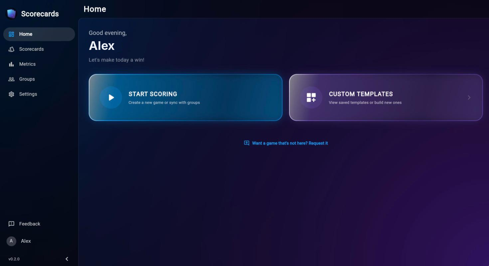
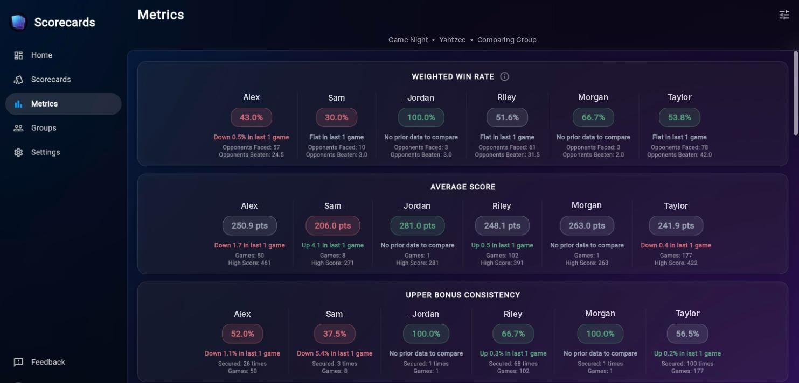

# Scorecards — Game Score Tracker

A Flutter app for keeping score in card and board games with friends. It has built-in scorecards for popular games, a template builder for any other game, and stats that sync across every player's device.

**Live web app:** [scorecards.axisoptic.com](https://scorecards.axisoptic.com)



## Overview

Scorecards replaces the paper score sheet. Create a group, invite your friends, pick a game and score it round by round. When a game is finished, everyone in the group is notified with the results, and the game feeds into per-game stats. If a game isn't built in, you can describe its scoring in the template builder or scan the scoring rules from its rulebook.

## Features




- **Built-in scorecards** for Spades, Nerts, Nines, Pit, Poker, Wavelength, Yahtzee and a standard points game, each with its own scoring rules.
- **Custom templates.** A step-by-step builder for any game's setup questions, data entry and scoring, plus a rulebook scanner that reads rules from a photo using on-device text recognition.
- **Groups.** Create game groups, invite friends, and get push notifications for invites and finished games.
- **Metrics.** Per-game stats and charts, with customizable metric views.
- **Split-screen scoring.** The scorecard and live stats side by side, on a resizable split.
- **Axis migration.** Imports game history from my earlier Axis App.
- **Web and mobile.** A responsive web version with a sidebar layout, alongside iOS and Android.
- **In-app feedback.** Feedback goes straight to my Optic developer dashboard, along with the app version.

## Built with

- [Flutter](https://flutter.dev) (Dart) for iOS, Android and web
- [Riverpod](https://riverpod.dev) for state management
- Firebase: Authentication (email and Google), Cloud Firestore, Cloud Messaging, Cloud Functions (Node.js) and Hosting
- Google ML Kit text recognition for rulebook scanning
- fl_chart for metrics charts

## Project structure

```
docs/screenshots/  images used in this README
lib/
  app/          app shell, routing, web sidebar
  core/         shared widgets, layout, version, web helpers
  features/
    auth/       sign in and sign up
    groups/     game groups and invites
    home/       dashboard
    scorecards/ game templates, scoring, template builder, rulebook scanner
    metrics/    per-game stats and charts
    settings/   preferences, mail inbox, feedback
  services/     Firestore and feedback services
functions/
  index.js      scorecard and invite notifications
  optic.js      connection to the Optic developer dashboard
test/           unit tests for templates, the rulebook parser and feedback
```

## Running locally

1. Install the [Flutter SDK](https://docs.flutter.dev/get-started/install).
2. Create a Firebase project and run `flutterfire configure`. The platform config files (`google-services.json`, `GoogleService-Info.plist`) are not included in the repo.
3. Run `flutter pub get`, then `flutter run` (or `flutter run -d chrome` for the web version).
4. Run tests with `flutter test`.

## Deployment

```bash
flutter build web
firebase deploy --only hosting,functions
```

## How it was built

This project was built with AI-assisted development. I designed the app and directed the work, and I used **Claude** (Anthropic) and **Gemini** in **Google Antigravity** to write and iterate on the code. Each release is tagged, and the [changelog](CHANGELOG.md) lists what changed in each one.

## Status

**Current version: 0.2.0.** The app is in active development. Planned next: Apple sign-in and offline caching.

## License

The source code is available under the [MIT License](LICENSE). The Scorecards and Axis Optic names and logos are not covered by the license.
