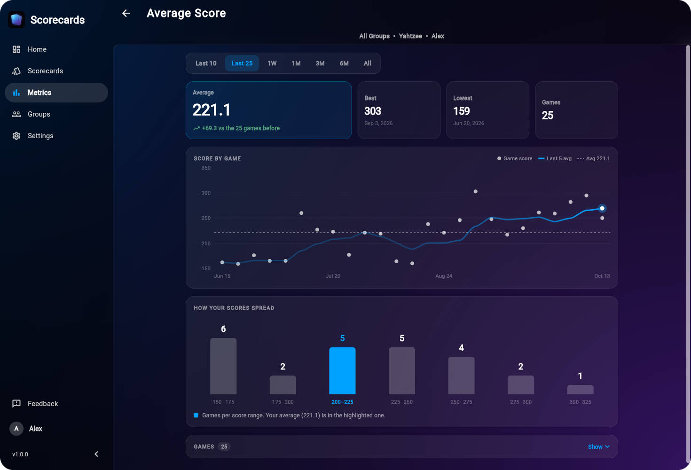
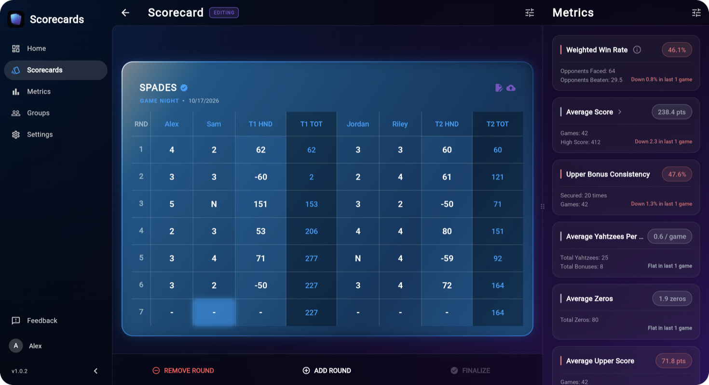

# Scorecards — Game Score Tracker

A Flutter app for keeping score in card and board games with friends. It has built-in scorecards for popular games, a template builder for any other game, and stats that sync across every player's device.

**Live site:** [scorecards.axisoptic.com](https://scorecards.axisoptic.com)


## Overview

Scorecards replaces the paper score sheet. Create a group, invite your friends, pick a game and score it round by round. When a game is finished, everyone in the group is notified with the results, and the game feeds into per-game stats. If a game isn't built in, you can describe its scoring in the template builder or scan the scoring rules from its rulebook.

## Features






- **Built-in scorecards** for Spades, Nerts, Nines, Pit, Poker, Wavelength, Yahtzee and a standard points game, each with its own scoring rules.
- **Custom templates.** A step-by-step builder for any game's setup questions, data entry and scoring, plus a rulebook scanner that reads rules from a photo using on-device text recognition.
- **Groups.** Create game groups, invite friends, and get push notifications for invites and finished games.
- **Invite links.** Send a link for a player you've been scoring as a local player; when they make an account from it, they take that player's place and their past games come with them.
- **Metrics.** Per-game stats with customizable views, and a detailed stats screen for each one: every game on a chart with a rolling average, how scores spread out, and a comparison with the previous period.
- **Split-screen scoring.** The scorecard and live stats side by side, on a resizable split.
- **Axis migration.** Imports game history from my earlier Axis App.
- **Web and mobile.** A responsive web version with a sidebar layout, alongside iOS and Android.
- **In-app feedback.** Feedback goes straight to my Axis Optic inbox, along with the app version.

## Built with

- [Flutter](https://flutter.dev) (Dart) for iOS, Android and web
- [Riverpod](https://riverpod.dev) for state management
- Firebase: Authentication (email and Google), Cloud Firestore, Cloud Messaging, Cloud Functions (Node.js) and Hosting
- Google ML Kit text recognition for rulebook scanning
- fl_chart for metrics charts

## Project structure

```
docs/screenshots/  images used in this README
lib/
  app/          app shell, routing, web sidebar
  core/         shared widgets, layout, version, web helpers
  features/
    auth/       sign in and sign up
    groups/     game groups, invites and invite links
    home/       dashboard
    premium/    premium beta flag for testing features (switched on from Console)
    scorecards/ game templates, scoring, template builder, rulebook scanner
    metrics/    per-game stats and charts
    settings/   preferences, mail inbox, feedback
  services/     Firestore and feedback services
functions/
  index.js      scorecard and invite notifications, account lookup for invites
  console.js    connection to Console, my Axis Optic developer app
firestore.rules database security rules
firestore_tests/ tests for the security rules (Firestore emulator)
test/           tests for templates, the rulebook parser, feedback, premium beta and stats
```

## Running locally

1. Install the [Flutter SDK](https://docs.flutter.dev/get-started/install).
2. Create a Firebase project and run `flutterfire configure`. The platform config files (`google-services.json`, `GoogleService-Info.plist`) are not included in the repo.
3. Run `flutter pub get`, then `flutter run` (or `flutter run -d chrome` for the web version).
4. Run tests with `flutter test`. The database rules tests run with `npm install && npm test` in `firestore_tests/` (needs Java for the Firestore emulator).

## Security

The Firestore rules deny everything the app doesn't need. Personal scorecards, mail, settings and templates are private to their owner. Only members can see a group and its scorecards. Joining a group takes an invite: a pending invite from a member, or an unused invite link. Profiles can't be listed or searched; a Cloud Function finds accounts by email for invites. In-app mail can only come from someone in the same group. Premium beta is a sign-in claim that only the server can set. Feedback isn't stored in Scorecards' database at all: it goes to Axis Optic's `feedback` function, which shows each user only their own tickets, and `functions/console.js` accepts calls only from Axis Optic's server. The rules tests in `firestore_tests/` check that the app's normal actions are allowed and that each of these is enforced.

## Deployment

```bash
flutter build web
firebase deploy --only hosting,functions,firestore:rules
```

## How it was built

This project was built with AI-assisted development. I designed the app and directed the work, and I used **Claude** (Anthropic) and **Gemini** in **Google Antigravity** to write and iterate on the code. Each release is tagged, and the [changelog](CHANGELOG.md) lists what changed in each one.

## Axis Optic integration

Scorecards connects to Axis Optic, the Firebase project behind Console, my developer app for my apps:

- In-app feedback is stored in Axis Optic, not in Scorecards' database, and arrives in Console along with the app version.
- Console can list Scorecards users and change their settings through `functions/console.js`, which only accepts calls from Axis Optic's server.
- **Premium beta** is a developer testing mode. I switch it on per account from Console to try out features, and what a premium version could look like, before they're released to everyone. Custom templates are currently behind it, and the database rules only let premium beta accounts save templates.

## Status

**Current version: 1.0.5.** In active development. See the [changelog](CHANGELOG.md) for version history. Planned next: Apple sign-in and offline caching.

## License

The source code is available under the [MIT License](LICENSE). The Scorecards and Axis Optic names and logos are not covered by the license.
